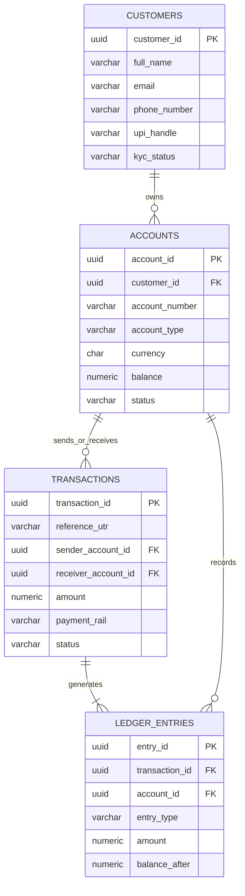

# 🏦 FinTech Double-Entry Ledger & UPI Payment Database

A production-grade relational database architecture built for **PostgreSQL**, modeling Indian digital banking, UPI/IMPS payment rails, and immutable double-entry ledger auditing.

---

## 📐 Entity-Relationship Architecture



---

## 📂 Repository Structure

| File | Purpose |
| :--- | :--- |
| `schema.sql` | Normalized PostgreSQL tables, UUID keys, `CHECK` constraints, and composite indexes. |
| `seed_data.sql` | Sample Indian customer profiles, INR accounts, and balanced double-entry UPI/IMPS records. |
| `analytics_queries.sql` | Audit verification queries, payment rail metrics, and passbook statement views. |

---

## 🛡️ Key Engineering Safeguards
* **Zero-Sum Double-Entry Accounting:** Every completed transaction writes both a `DEBIT` and a `CREDIT` entry in `ledger_entries` so total debits always equal total credits.
* **Overdraft & Self-Transfer Protection:** Database-level `CHECK` constraints enforce `balance >= 0.00` and prevent `sender_account_id = receiver_account_id`.
* **High-Speed Indexing:** Composite B-Tree indexes on `(account_id, recorded_at DESC)` and `upi_handle` ensure millisecond passbook and payment lookups.

---

## 🚀 Quick Start (PostgreSQL)

```bash
psql -U postgres -d fintech_db -f schema.sql
psql -U postgres -d fintech_db -f seed_data.sql
psql -U postgres -d fintech_db -f analytics_queries.sql
```

